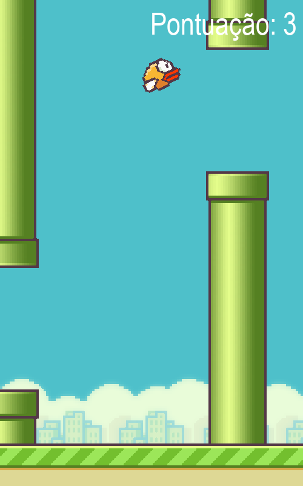

# 🐦 Flappy Bird em Python

Recriação do clássico **Flappy Bird** feita em Python com [Pygame](https://www.pygame.org/).



## Funcionalidades

- Física de gravidade e pulo com rotação do pássaro
- Animação das asas
- Canos gerados em alturas aleatórias
- Colisão por máscara de pixels (precisa, sem "caixas" invisíveis)
- Chão com rolagem infinita
- Pontuação e recorde da sessão
- Tela de fim de jogo com reinício pela barra de espaço

## Como rodar

Requer **Python 3.10+**.

```bash
git clone https://github.com/MjesusGyn/flappy-bird.git
cd flappy-bird

python -m venv .venv
# Windows
.venv\Scripts\activate
# Linux / macOS
source .venv/bin/activate

pip install -r requirements.txt
python flappy_bird.py
```

## Controles

| Tecla | Ação |
|-------|------|
| `Espaço` | Pular / jogar de novo |
| Fechar a janela | Sair |

## Estrutura

```
flappy-bird/
├── flappy_bird.py     # código do jogo
├── imgs/              # sprites (pássaro, cano, chão e fundo)
└── requirements.txt
```

O código é organizado em três classes — `Passaro`, `Cano` e `Chao` — e um loop principal em `main()`.

## Créditos

Projeto desenvolvido durante o curso **Python Impressionador** da [Hashtag Treinamentos](https://www.hashtagtreinamentos.com/), com melhorias próprias (tela de fim de jogo, reinício e recorde).
Sprites baseados no jogo original *Flappy Bird*, de Dong Nguyen.
